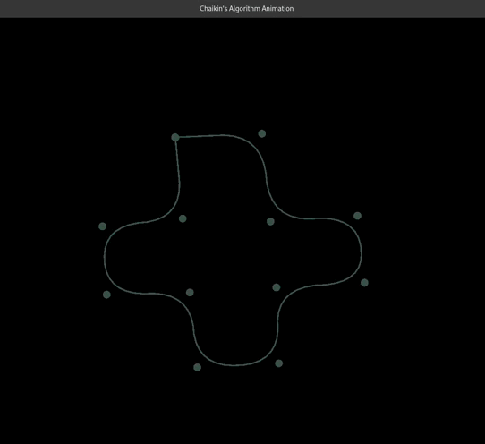

# Chaikin's Algorithm Animation Project: An Exquisite Implementation of a Timeless Concept

## Demo 🎥

<div style="align-items: center; justify-content: center;">
  
</div>

## Introduction

_In the realm of computer graphics, the pursuit of creating smooth, aesthetically pleasing curves from a set of points or a polyline has been a longstanding challenge._

_Chaikin's algorithm, a seminal method devised to address this issue, has been a cornerstone in the field, renowned for its efficacy in refining and smoothing curves. This project undertakes the ambitious task of not only implementing Chaikin's algorithm but also presenting it in a visually captivating animation, thereby providing an immersive experience for the user._
_In the realm of computer graphics, the pursuit of creating smooth, aesthetically pleasing curves from a set of points or a polyline has been a longstanding challenge._

_Chaikin's algorithm, a seminal method devised to address this issue, has been a cornerstone in the field, renowned for its efficacy in refining and smoothing curves. This project undertakes the ambitious task of not only implementing Chaikin's algorithm but also presenting it in a visually captivating animation, thereby providing an immersive experience for the user._

## Project Overview

_The project aims to provide a comprehensive and immersive experience for users by implementing Chaikin's algorithm and presenting it in an animation. By combining the algorithm's elegance with the visual appeal of an animation, the project offers a unique and engaging way to explore the concept of curve smoothing. The instrutions for the proect can be found [here](INSTRUCTIONS.md).
At its core, Chaikin's algorithm operates by iteratively introducing new points along each line segment at 25% and 75% of the distance between the original points. This process, repeated over multiple iterations, yields a curve of remarkable smoothness, effectively mitigating the angularity of the original polyline. The algorithm's versatility and efficiency make it an indispensable tool in various applications, from graphic design to engineering, where the creation of smooth curves is paramount._
_The project aims to provide a comprehensive and immersive experience for users by implementing Chaikin's algorithm and presenting it in an animation. By combining the algorithm's elegance with the visual appeal of an animation, the project offers a unique and engaging way to explore the concept of curve smoothing. The instrutions for the proect can be found [here](INSTRUCTIONS.md).
At its core, Chaikin's algorithm operates by iteratively introducing new points along each line segment at 25% and 75% of the distance between the original points. This process, repeated over multiple iterations, yields a curve of remarkable smoothness, effectively mitigating the angularity of the original polyline. The algorithm's versatility and efficiency make it an indispensable tool in various applications, from graphic design to engineering, where the creation of smooth curves is paramount._

## 📚 Table of Contents

- [Chaikin's Algorithm Animation Project: An Exquisite Implementation of a Timeless Concept](#chaikins-algorithm-animation-project-an-exquisite-implementation-of-a-timeless-concept)
  - [Demo 🎥](#demo-)
  - [Introduction](#introduction)
  - [Project Overview](#project-overview)
  - [📚 Table of Contents](#-table-of-contents)
  - [User Interation](#user-interation)
    - [Creating a point](#creating-a-point)
    - [Animation](#animation)
    - [🎮 Control and Navigation](#-control-and-navigation)
  - [Implementation Details (How it Works)](#implementation-details-how-it-works)
    - [Quick Basic controls](#quick-basic-controls)
    - [📁 Project Structure](#-project-structure)
  - [⚙️ Quick Start](#️-quick-start)
    - [1. Clone and Build](#1-clone-and-build)
    - [2. Run the Program.](#2-run-the-program)
  - [🧪 Usage](#-usage)
    - [💡 Default Run](#-default-run)
    - [🧪 Run with Debug Info](#-run-with-debug-info)
    - [🧹 Clean Build Files](#-clean-build-files)
    - [📦 Rebuild Everything](#-rebuild-everything)
    - [🧪 Run tests](#-run-tests)
    - [💻 Code Venture](#-code-venture)
      - [📄 main.rs](#-mainrs)
      - [📄 lib.rs](#-librs)
      - [📄 src/app/mod.rs](#-srcappmodrs)
      - [📄 src/app/messages.rs](#-srcappmessagesrs)
      - [📄 src/app/model.rs](#-srcappmodelrs)
        - [🧠 Field Overview](#-field-overview)
      - [📄 src/app/update.rs](#-srcappupdaters)
      - [📄 src/app/view.rs](#-srcappviewrs)
      - [📄 src/app/algorithms/chaikin.rsview.rs](#-srcappalgorithmschaikinrsviewrs)
      - [📄 src/app/algorithm/chaikin.rs](#-srcappalgorithmchaikinrs)
      - [📄 src/app/algorithm/mod.rs](#-srcappalgorithmmodrs)
  - [Customization 🎨](#customization-)
  - [🛠️ Technology Stack](#️-technology-stack)
  - [Testing](#testing)
  - [Conclusion](#conclusion)
  - [License 📜](#license-)
  - [Contributions 🤝](#contributions-)
    - [Contributors 🌟](#contributors-)


---

## User Interation

### Creating a point

_The program is designed to be highly interactive, allowing users to draw one or more points on a canvas using the left mouse button. This intuitive interface enables users to explore the algorithm's capabilities in a hands-on manner._

- _The user can create as much points on the canvas as desired._

### Animation

_Upon pressing the, the `Enter` key, the program initiates an animation that vividly illustrates each step of Chaikin's algorithm. This visual representation not only enhances understanding but also provides a mesmerizing display of how the algorithm progressively refines the curve._

### 🎮 Control and Navigation

_The application includes a range of controls. Pressing `Escape` allows users to exit the application and minimize the windowFurthermore, holding down the `Control key` and dragging the point in a certain direction, facilitates the real-time movement of control points, offering unparalleled flexibility and precision, making the focused-point to be manipulated in real-time rational to the curve and finally pressing `r` key resets/clears the canvas, enabling users to start anew._

---

## Implementation Details (How it Works)

_The implementation of Chaikin's algorithm in this project is a testament to the power of meticulous design and coding. By leveraging the capabilities of modern programming languages like the Rust Progrmming language, the project achieves a balance between complexity and simplicity, making it accessible to a wide range of users, from novice programmers to seasoned developers._

### Quick Basic controls

- Draw one or more points on a canvas using the left mouse button.
- Press `Enter` to start the animation, which illustrates each step of Chaikin's algorithm.
- Press `Escape` to quit the application.
- Press `r` to reset the canvas and draw new points.
- Hold down the `Control` key and drag the mouse to move a point in real time.

---

### 📁 Project Structure

_This document outlines the purpose and organization of each file and directory in the project._

```sh
.
├── Docs/
│    ├── INSTRUCTIONS.md
│    ├── LICENSE.md
│    └── README.md
│
├── src/
│     ├── app/
│     │   ├── mod.rs
│     │   ├── messages.rs
│     │   ├── model.rs
│     │   ├── update.rs
│     │   ├── view.rs
│     │   └── algorithm/
│     │       ├── mod.rs
│     │       └── chaikin.rs
│     ├──tests/
│     │   └── tests.rs
│     ├── lib.rs
│     └──main.rs
├── .gitignore
├── Cargo.lock
├── Cargo.toml
└── Makefile

```

---

## ⚙️ Quick Start

### 1. Clone and Build

```bash
git clone https://learn.zone01kisumu.ke/git/johnodhiambo0/chaikin.git
cd chaikin
make setup
```

### 2. Run the Program.

```sh
make run
```

- No need to remember long Cargo commands anymore — we've got a Makefile for that!

## 🧪 Usage

<div style="display: flex; gap: 11px;">
<div style="flex: 1">

### 💡 Default Run

```sh
make run
```

</div>  <div style="border-left: 1px solid #ccc; height: auto;"></div> <div style="flex: 1">

### 🧪 Run with Debug Info

```sh
make debug
```

</div>  <div style="border-left: 1px solid #ccc; height: auto;"></div> <div style="flex: 1">

### 🧹 Clean Build Files

```sh
make clean
```

</div>  <div style="border-left: 1px solid #ccc; height: auto;"></div> <div style="flex: 1">

### 📦 Rebuild Everything

```sh
make rebuild
```

</div>  <div style="border-left: 1px solid #ccc; height: auto;"></div> <div style="flex: 1">

### 🧪 Run tests

```sh
make test
```

</div> </div>

- The Makefile simplifies building, running, and cleaning up. Modify it to extend functionality as needed.

---

### 💻 Code Venture

#### 📄 main.rs

_This is the entry point of a GUI application built with the `iced framework`, a cross-platform GUI library for Rust inspired by Elm._

```rs
mod app;
use app::App;
use iced::Application;

pub fn main() -> iced::Result {
    App::run(iced::Settings::default())
}
```

_This file content will launch the GUI application with the default setting configuration (like window size, theme, flags)._
_The function returns a vslid resoponse, and check for errors if anyt from the implied crate_

#### 📄 lib.rs

_Declares the app module and makes it public—accessible from other modules or crates (like tests, or when used as a dependency)._

- _It is the entry point of the other crates and tests_

#### 📄 src/app/mod.rs

**1** 🧠 **Application Lifecycle** – `impl Application for App`

- _Implements the iced::Application trait, defining how the app starts, updates, renders, and reacts to user input_

| Method           | Purpose                                                     |
| ---------------- | ----------------------------------------------------------- |
| `new()`          | Initializes the app with default state.                     |
| `title()`        | Sets window title: `"Chaikin's Algorithm Animation"`        |
| `view()`         | Renders the app by drawing the model on a full-size canvas. |
| `update()`       | Reacts to messages (like user inputs or ticks).             |
| `subscription()` | Triggers regular updates if animation is running.           |

**2**🎨 **Canvas Interactivity** – `impl canvas::Program`

- _This part gives the model direct access to canvas interactivity, like mouse clicks, key presses, or drawing._

| Method     | Purpose                                                      |
| ---------- | ------------------------------------------------------------ |
| `update()` | Reacts to canvas-level events like mouse or keyboard input.  |
| `draw()`   | Delegates drawing to the `view` module using the `Renderer`. |

**3**🖱 **Event Highlights**

- _Mouse Click: Adds point or selects point if Control is pressed._

- _Keyboard:_

  - `Enter`: Starts animation.

  - `Escape`: Quits.

  - `r`: Resets.

  - `Ctrl`: Enables drag mode.

- _**Cursor Move**: Moves a selected point while dragging._

**4**
🔗 **Integration**

- _This module file is the bridge between user input, state management, and graphical rendering. It enables:_

  - Smooth animations via Subscription.

  - Interactive drawing/editing of points.

  - Application flow managed through declarative Messages.

#### 📄 src/app/messages.rs

- _The file contains the Messages enum, with action variants, which defines the different types of messages that can be sent to the app._
- _These messages update the state of the app, in every instance called. The update happens in the `src/app/update.rs` file._
- _Here is wat each variant does:_

| Variant               | Purpose                                                            |
| --------------------- | ------------------------------------------------------------------ |
| `RunChaikinAnimation` | Triggered when user presses `Enter` to start Chaikin's animation.  |
| `Tick`                | Fired periodically during animation to proceed to the next frame.  |
| `MousePressed(Point)` | Called when user clicks on the canvas to place a point.            |
| `Reset`               | Resets the state (e.g., clears points).                            |
| `Quit`                | Terminates the application.                                        |
| `MovePoint(Point)`    | Moves a selected point (when dragging with Control key held down). |

#### 📄 src/app/model.rs

- _This file defines the core Model struct that holds the entire application state for the Chaikin's curve animation and user interactions._

##### 🧠 Field Overview

| Field               | Type                            | Purpose                                                  |
| ------------------- | ------------------------------- | -------------------------------------------------------- |
| `points`            | `Vec<Point>`                    | Stores user-defined input points.                        |
| `chaikin_points`    | `Vec<Point>`                    | Stores points generated by Chaikin’s algorithm.          |
| `iteration`         | `usize`                         | Max number of iterations for curve refinement.           |
| `current_iteration` | `usize`                         | Current iteration step during animation.                 |
| `run_animation`     | `RefCell<bool>`                 | Indicates if animation is running.                       |
| `control_pressed`   | `RefCell<bool>`                 | Tracks whether Ctrl key is held (for dragging behavior). |
| `dragging`          | `RefCell<bool>`                 | True if a point is being dragged.                        |
| `drag_point`        | `RefCell<Option<(usize, Point)` | Stores index and coordinates of the point being dragged. |

#### 📄 src/app/update.rs

| Message Variant          | Behavior                                                                                                                                |
| ------------------------ | --------------------------------------------------------------------------------------------------------------------------------------- |
| `MousePressed(position)` | Adds the clicked point (`position`) to `model.points`.                                                                                  |
| `RunChaikinAnimation`    | Starts the animation by setting `run_animation` to `true`, only if it isn’t already running.                                            |
| `Tick`                   | Drives the animation loop. If conditions are met, computes Chaikin points iteratively.                                                  |
|                          | - If only two points exist, they are cloned directly.                                                                                   |
|                          | - Otherwise, applies Chaikin algorithm using current iteration.                                                                         |
|                          | - Stops generating new Chaikin points if the maximum number of iterations has been reached or if there aren’t enough points to process. |
| `Quit`                   | Terminates the application.                                                                                                             |
| `Reset`                  | Clears all points, Chaikin points, resets iteration, and stops the animation.                                                           |
| `MovePoint(position)`    | If dragging is active, updates the position of the dragged point in `model.points`.                                                     |

#### 📄 src/app/view.rs

- _Below is a list of components in the view.rs file, along with their respective functions and purposes:_

| Component                             | Description                                                            |
| ------------------------------------- | ---------------------------------------------------------------------- |
| `view` function                       | Responsible for rendering the model’s current state onto the canvas.   |
| `renderer: &Renderer`                 | Reference to the renderer used for drawing.                            |
| `model: &Model`                       | Provides access to points and Chaikin-smoothed points.                 |
| `bounds: Rectangle`                   | The drawable area within the window.                                   |
| `Frame::new(...)`                     | Initializes a new canvas drawing frame.                                |
| `Path::new(...circle...)`             | Draws small circles for each raw point in `model.points`.              |
| `Color::BLACK`                        | The color used for point fill and smoothed line stroke.                |
| `if !model.chaikin_points.is_empty()` | Conditionally draws the smoothed line only if points exist.            |
| `path_builder.move_to(...)`           | Starts drawing from the first Chaikin point.                           |
| `path_builder.line_to(...)`           | Draws straight lines through all smoothed points.                      |
| `Stroke` object                       | Defines stroke style, width, and line caps/joins for the Chaikin path. |
| `frame.stroke(...)`                   | Renders the Chaikin path with the defined stroke style.                |
| `frame.into_geometry()`               | Converts the frame into drawable geometry for the canvas.              |

#### 📄 src/app/algorithms/chaikin.rsview.rs

#### 📄 src/app/algorithm/chaikin.rs

_This file contains the implementation of Chaikin's algorithm, which is used to smooth a polyline by iteratively refining its points._

| Function/Component                     | Purpose                                                                                                                                                           |
| -------------------------------------- | ----------------------------------------------------------------------------------------------------------------------------------------------------------------- |
| `chaikin(points, iterations)`          | The main function that implements Chaikin's algorithm. It takes a list of points and the number of iterations as input and returns a new list of smoothed points. |
| `Point`                                | Represents a 2D point with `x` and `y` coordinates. Used to define the polyline and its smoothed version.                                                         |
| `new_points.push(...)`                 | Adds new points to the polyline by calculating intermediate points at 25% and 75% of the distance between consecutive points.                                     |
| `chaikin(&new_points, iterations - 1)` | Recursively calls itself to perform the specified number of iterations, progressively refining the polyline.                                                      |

_This file is a core part of the project, as it defines the algorithm that drives the animation and curve smoothing functionality._

#### 📄 src/app/algorithm/mod.rs

_This file serves as the module entry point for the `algorithm` directory. It organizes and exposes the functionality of the Chaikin's algorithm implementation._

| Component                  | Purpose                                                                                                                                           |
| -------------------------- | ------------------------------------------------------------------------------------------------------------------------------------------------- |
| `pub mod chaikin`          | Declares the `chaikin` module, making it accessible within the project.                                                                           |
| `pub use chaikin::chaikin` | Re-exports the `chaikin` function, allowing it to be used directly by other modules without needing to reference the `chaikin` module explicitly. |

_This file simplifies access to the Chaikin's algorithm implementation and ensures modular organization within the project._

---

## Customization 🎨

_If you wish to customize the appearance of the application, such as changing the **window background color**, **point color**, or **point size**, you can do so by modifying the appropriate lines in the source code:_

- **Window Background Color**:  
  Modify the file `src/app/view.rs` at the line where the background color is defined. Update the color value to your desired color. i.e for instance I need the background color to be `amber` and the color is `Color::from_rgb8(255, 192, 203)`.

```rs
frame.fill_rectangle(
    Point::ORIGIN,
    bounds.size(),
    Color::BLACK, //change here
);
```

- **Point Color**:  
  Change the color of the points by editing the file `src/app/view.rs` at the line where the point color is specified.

```rs
for point in &model.points {
  let circle = Path::new(|b| b.circle(*point, 5.0));
  frame.fill(&circle, Color::from_rgb8(57, 82, 70)); // change here
}
```

- **Point Size**:  
  Adjust the size of the points by modifying the file `src/app/view.rs` at the line where the point size is set.

```rs
for point in &model.points {
  let circle = Path::new(|b| b.circle(*point, 5.0)); // change here
  frame.fill(&circle, Color::from_rgb8(57, 82, 70));
}
```

- **Text color**:  
  Change the color of the text displayed on the screen by editing the file `src/app/view.rs` at the line where the text color is specified.
  For instance if we need the text color to be `amber` and the color is `Color::from_rgb8(255, 192, 203)`. Remeber to have a consisent color for the points and the strokes, consider updating the color of the the strokes as well.

```rs
let status_text = Text {
    content: model.status_message.borrow().to_string(),
    position: Point::new(10.0, 20.0),
    color: Color::from_rgb8(255, 192, 203), // change here
    size: iced::Pixels(16.0),
    ..Text::default()
};
```

strokes' color modification;

```rs
let stroke = Stroke {
  style: Style::Solid(Color::from_rgb8(255, 192, 203)), // change here
  line_dash: LineDash::default(),
  width: 2.0,
  line_cap: stroke::LineCap::Round,
  line_join: LineJoin::Round,
};
```

_Feel free to experiment with these values to achieve the look and feel that suits your preferences!_ 🎉

## 🛠️ Technology Stack

_Some of the technology stack used in the Chaikin's Algorithm Animation project includes:_

- `Front-end:` Rust, Iced framework
- `Back-end:` None (since it's a client-side application)
- `Infrastructure:` Cargo (Rust package manager)
- `Tools and Libraries:` Git (version control), Clippy (Rust linter)

---

## Testing

_To ensure the correctness of the Chaikin's algorithm implementation, we will use the iced testing framework. The testing framework will consist of the following components:_

- `tests.rs:` A test module that contains unit tests for the Model and View components

- _Run the tests using the command:_

```sh
cargo test
```

_This will execute the test cases and report any failures or errors._

## Conclusion

_The Chaikin's Algorithm Animation project stands as a shining example of how complex mathematical concepts can be transformed into engaging, interactive experiences. Through its rich interface, detailed animation, and user-centric design, this project not only educates but also inspires, inviting users to explore the fascinating world of computer graphics and algorithmic design. Whether you are a student seeking to understand the intricacies of Chaikin's algorithm, a developer looking to integrate smooth curve generation into your projects, or simply an enthusiast of computer graphics, this project is sure to captivate and enlighten._

---

## License 📜

_This project is licensed under the terms specified in the [LICENSE](LICENSE.md) file. By using this project, you agree to adhere to the terms and conditions outlined in the license. Feel free to explore, modify, and share the project within the boundaries of the license._

## Contributions 🤝

_We welcome contributions from the community! Whether it's fixing bugs, adding new features, improving documentation, or sharing ideas, your input is highly valued._ To contribute:

1. Fork the repository 🍴.
2. Create a new branch for your feature or fix (`git checkout -b feature-name`) 🌱.
3. Commit your changes (`git commit -m "Add a meaningful message"`) 💬.
4. Push your branch (`git push origin feature-name`) 🚀.
5. Open a pull request and describe your changes 📝.

_Please ensure your contributions align with the project's goals and coding standards. For more details, refer to the [CONTRIBUTING](CONTRIBUTING.md) file (if available)._

### Contributors 🌟

_A huge thank you to all the amazing contributors who have helped make this project better! You can find the list of contributors in the [LICENSE](LICENSE) file. Your efforts are greatly appreciated!_ 🙌

---

_Let’s build something amazing together!_ 💻✨
